# 🎧 Spotify Music Analytics

### What makes a song popular? An exploratory analysis and machine-learning study of 114,000 Spotify tracks


Every track on Spotify has a popularity score from 0 to 100, along with audio features such as danceability, energy and loudness. I wanted to find out whether you can tell how popular a song will be just from how it sounds and what genre it belongs to.

This project takes the public Spotify Tracks Dataset, cleans it, explores it through 18 charts, answers five research questions with proper statistical tests, and compares five machine-learning models that sort tracks into **Low**, **Medium** and **High** popularity.

**The short answer:** genre matters a lot, but sound alone tells you surprisingly little. Most of what makes a hit isn't in the audio.

---

## 📌 Highlights

- **Genre explains about 26% of the variation in popularity.** It's the biggest single factor in the data.
- **No audio feature is more than weakly linked to popularity** (every |r| is 0.10 or less).
- **Audio features are very good at telling genres apart** (eta² is up to 0.50).
- **Explicit tracks are only slightly more popular.** Their real difference is that they have much more speech in them.
- **The best model, Logistic Regression, reaches a macro F1 of 0.507** and finds 60% of the genuinely popular tracks.

---

## 📂 Dataset

| | |
|---|---|
| **Name** | Spotify Tracks Dataset |
| **Size** | 114,000 tracks × 21 columns, across 114 genres |
| **Source** | [Kaggle](https://www.kaggle.com/datasets/maharshipandya/-spotify-tracks-dataset) · [Hugging Face](https://huggingface.co/datasets/maharshipandya/spotify-tracks-dataset), by *maharshipandya* |
| **Licence** | BSD (as listed on Hugging Face) |

The main columns are `popularity`, `duration_ms`, `explicit`, `danceability`, `energy`, `key`, `loudness`, `mode`, `speechiness`, `acousticness`, `instrumentalness`, `liveness`, `valence`, `tempo`, `time_signature` and `track_genre`.

The raw file is never modified. Its SHA-256 checksum is checked before and after processing.

---

## 🛠️ How the project is organised

The project is split into five scripts that run in order, so each stage can be read and run on its own:

```
spotify_project_sem5/
├── step1_main.py            # 1. Inspect the raw data
├── step2_preprocessing.py   # 2. Sample, clean and engineer features
├── step3_eda.py             # 3. Exploratory data analysis
├── step4_objectives.py      # 4. Research objectives 1–4
├── step5_train_models.py    # 5. Train and compare five classifiers
├── data/
│   ├── raw/dataset.csv
│   └── processed/spotify_tracks_cleaned.csv
├── models/best_model.joblib
├── outputs/
│   ├── model_comparison.csv
│   └── figures/             # all 18 charts
└── requirements.txt
```

---

## 🧹 Data cleaning

Rather than working on all 114,000 rows, I took a **reproducible, stratified sample of about 10,000 tracks** (`random_state=42`). The sample keeps the same mix of genres and popularity levels as the full dataset. The cleaning steps were:

1. **Dropped `Unnamed: 0`.** It was just a saved row index.
2. **Removed corrupt records.** One row in the full data had no artist, album or track name and a duration of 0 ms.
3. **Tidied the text.** I trimmed whitespace, lower-cased genres and checked for inconsistent spellings.
4. **Removed 3 exact duplicates.**
5. **Kept one row per track.** 291 songs appeared under more than one genre, and some of them had conflicting popularity values. Keeping only the first listing stops a song from ending up in both the training and test sets.
6. **Treated `tempo = 0` and `time_signature = 0` as missing.** These values mean no beat was detected. They're filled in later using training-data values only.
7. **Checked value ranges.** Unusual but genuine values, such as 20-minute tracks, were kept.

**Result:** a clean dataset of **9,703 tracks × 24 columns**.

I also added these features:

| Feature | Purpose |
|---|---|
| `popularity_category` | The target: **Low** (0–39), **Medium** (40–69), **High** (70–100) |
| `duration_min` | Track length in minutes, easier to read than milliseconds |
| `num_artists` | Number of credited artists, to capture collaborations |
| `rhythm_undetected` | Flags tracks where no beat was detected |

---

## 📊 Exploratory data analysis

### Popularity distribution

Popularity is spread widely, with a mean of 33.3 and a median of 34. There's a striking spike at zero: **13.8% of tracks have a popularity of 0.**

<p align="center">
  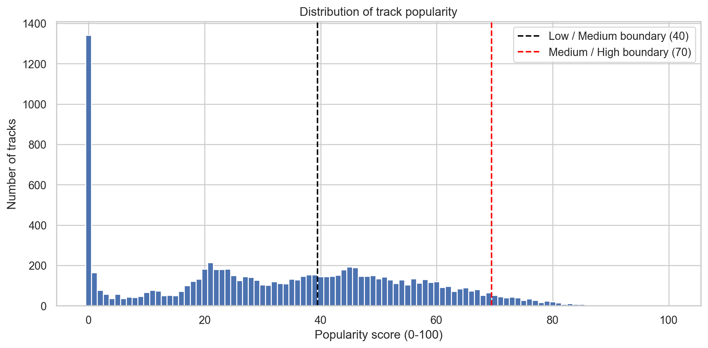
</p>

### Track duration

The median track is about 3.6 minutes long. The distribution has a long right tail, including 52 tracks longer than 10 minutes.

<p align="center">
  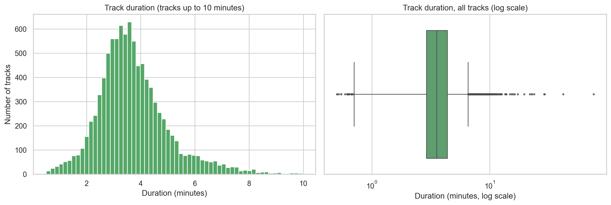
</p>

### Audio features vs popularity

None of the audio features shows a clear relationship with popularity. The scatter plots are essentially clouds.

<p align="center">
  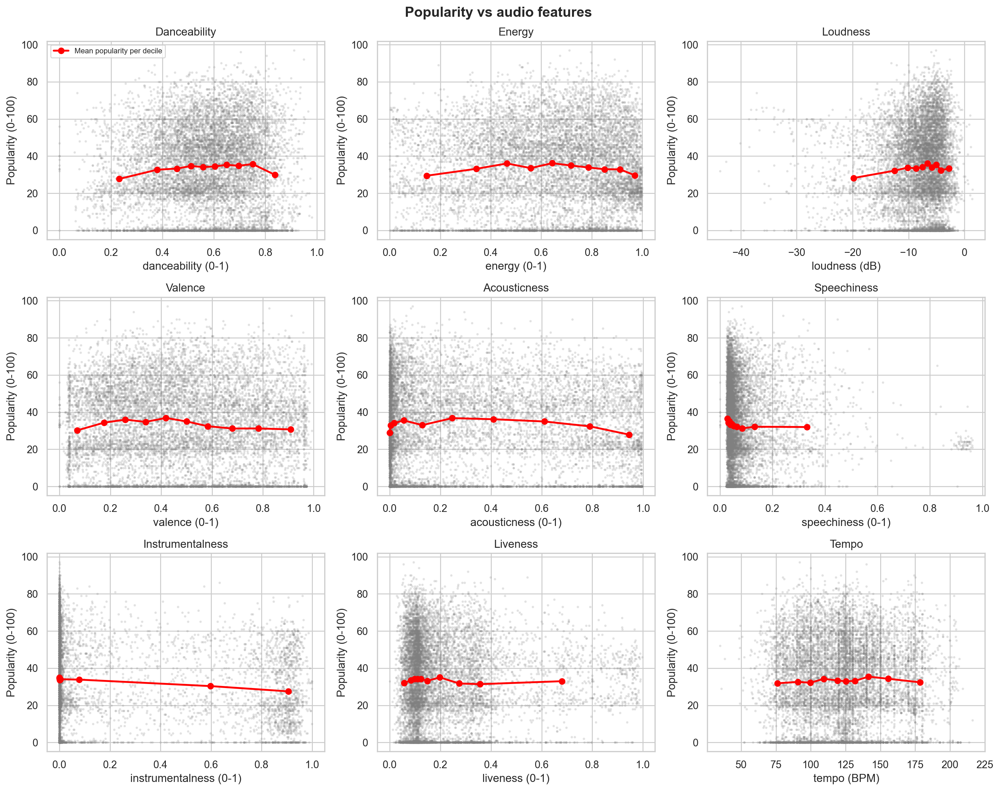
</p>

### Correlation heatmap

The audio features are strongly related **to each other** (energy and loudness: r = 0.76, energy and acousticness: r = −0.74). They are barely related to popularity. Only the lower triangle is shown, because the matrix is symmetric.

<p align="center">
  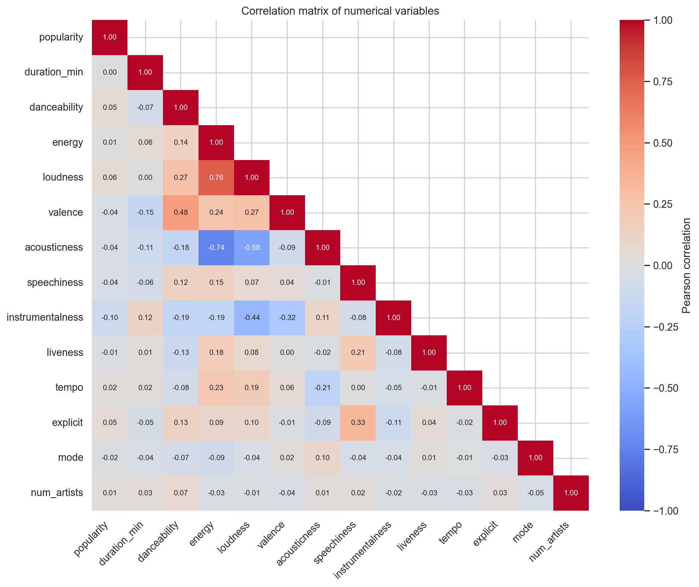
</p>

### Feature spread and class balance

<p align="center">
  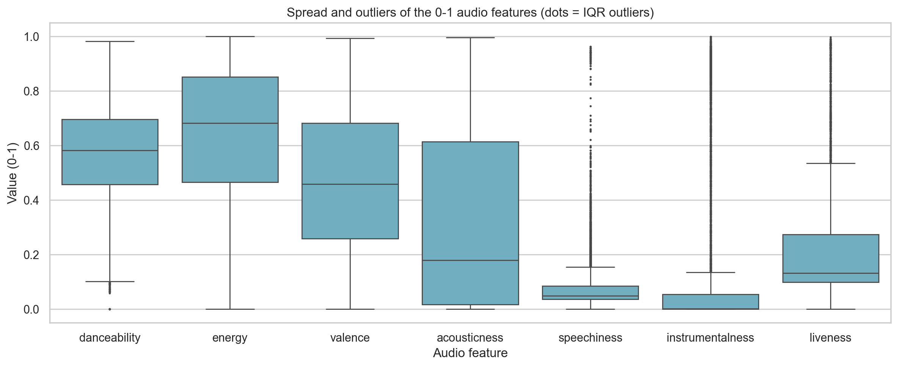
  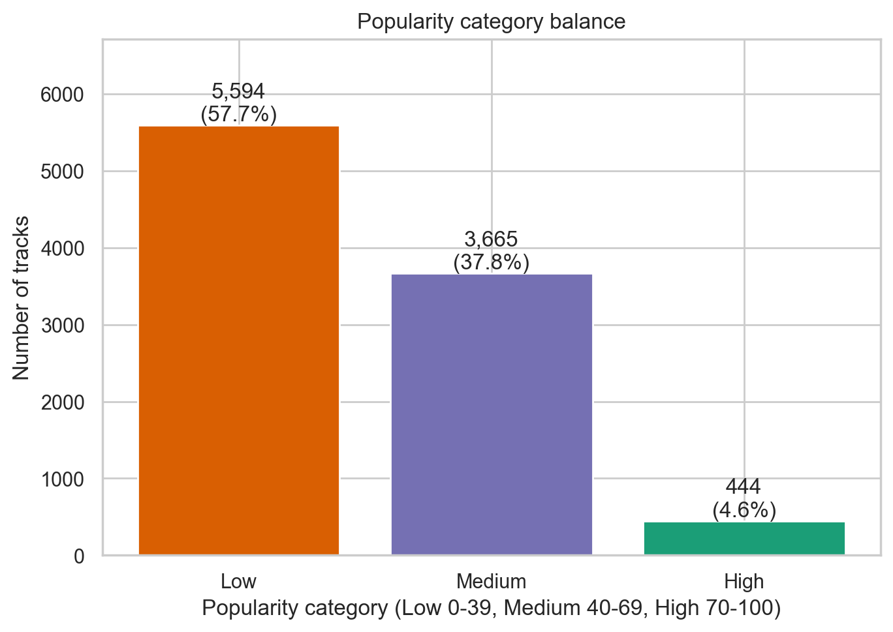
</p>

The classes are clearly imbalanced: **Low 57.7%, Medium 37.8%, High 4.6%.** For that reason I used **macro F1**, rather than accuracy, as the main metric for comparing models.

---

## 🔍 Research objectives

### Objective 1: Do some genres tend to be more popular?

**Yes, strongly.** Genre explains about **26%** of the variation in popularity (eta² = 0.26, Kruskal–Wallis p < 0.001).

- **Most popular genres:** pop-film (59.8), k-pop (56.9) and chill (53.8).
- **Least popular genres:** iranian (2.0), romance (2.7) and latin (8.4).

Many of the lowest-ranked genres have a large share of zero-popularity tracks, which may be a data-collection artefact rather than a real effect.

<p align="center">
  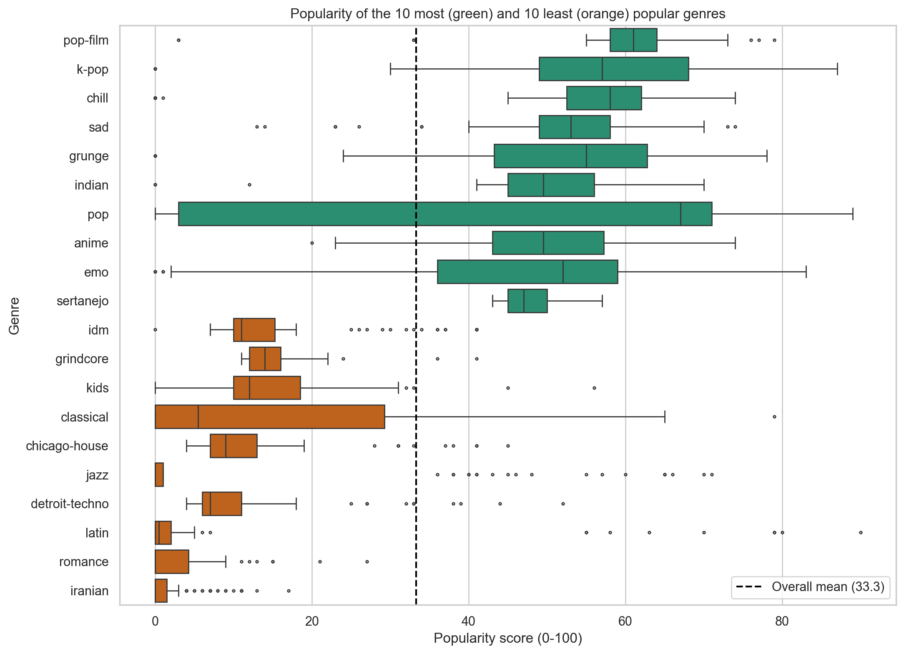
</p>

### Objective 2: Are audio features linked to popularity?

**Barely.** Every correlation is weak or negligible. The strongest is instrumentalness (Spearman ρ = −0.08), and most correlations shrink even further when you look within a single genre.

<p align="center">
  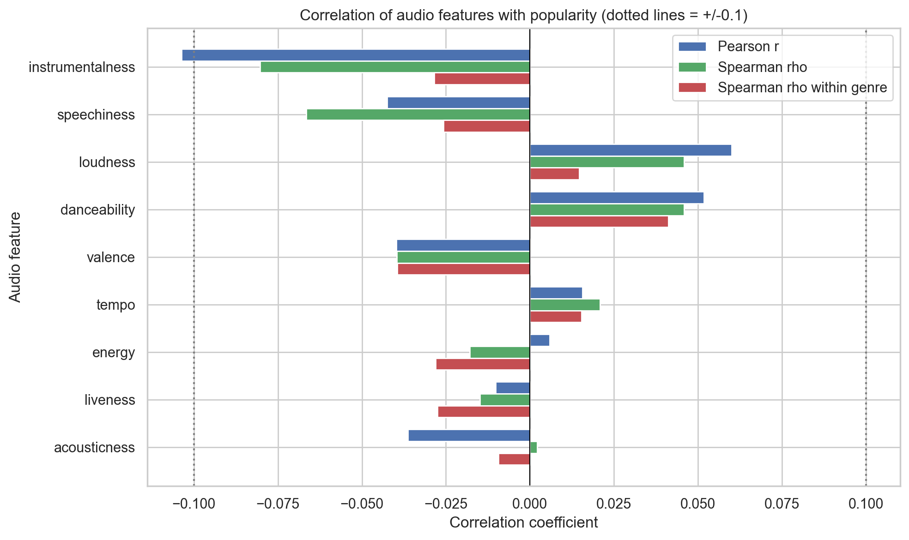
</p>

### Objective 3: Which audio characteristics separate genres?

This is where the audio features really stand out. **Six of the seven features show large differences between genres.** Acousticness leads the way (eta² = 0.50): black-metal averages 0.01 and classical averages 0.90.

<p align="center">
  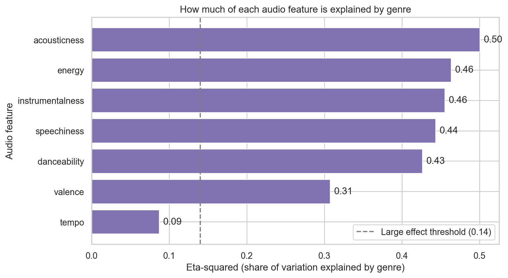
  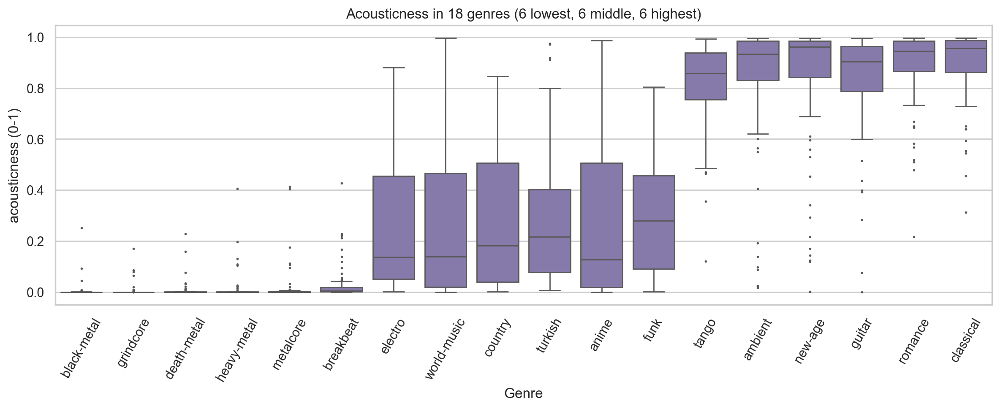
</p>

> In other words, audio features are much better at describing *what kind* of music a track is than *how popular* it is.

### Objective 4: Are explicit tracks different?

Only 8.2% of tracks are explicit. They score about **3.7 points higher** on popularity, but the effect is negligible (Cohen's d = 0.16). Within the same genre, the gap shrinks to just 1.5 points. The real difference is **speechiness** (d = 1.28): explicit tracks contain far more spoken words, and they also tend to be louder and more danceable.

<p align="center">
  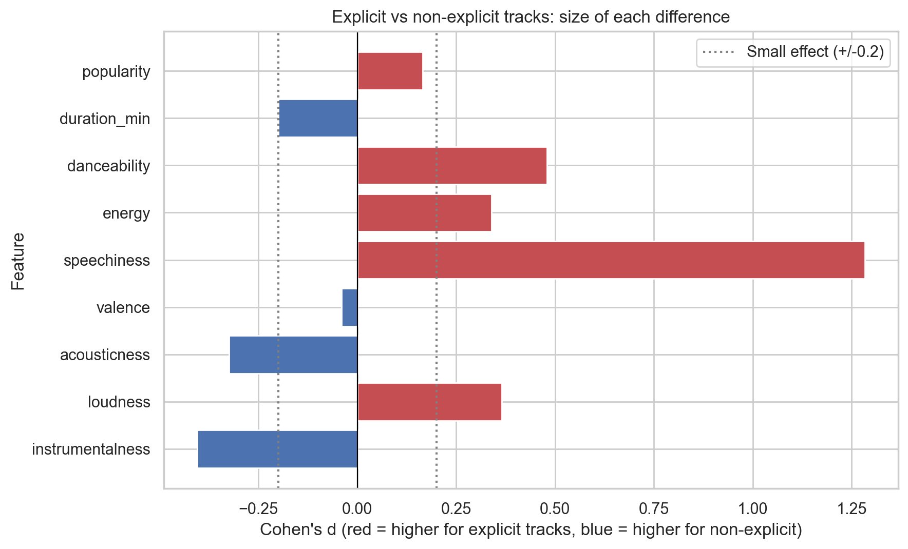
</p>

---

## 🤖 Objective 5: Predicting popularity with machine learning

### Setup

- **Inputs:** 17 features (audio features, genre, key, time signature and so on). One-hot encoding expands these to 144 columns.
- **Split:** 80/20, stratified, giving 7,762 training tracks and 1,941 test tracks.
- **No data leakage:** the split is made first, and imputation, encoding and scaling are all fitted on the training data only.
- **Excluded inputs:** the popularity score itself, track IDs, and artist, album and track names.

| Model | Key settings |
|---|---|
| Logistic Regression | `C=0.1`, `class_weight="balanced"` |
| Decision Tree | default |
| Random Forest | 200 trees, `min_samples_leaf=5`, `class_weight="balanced"` |
| K-Nearest Neighbours | `k=5`, scaled inputs |
| Gaussian Naive Bayes | `var_smoothing=1e-3` |

### Results on the test set

| Model | Accuracy | Precision | Recall | **Macro F1** | Weighted F1 |
|---|:---:|:---:|:---:|:---:|:---:|
| 🥇 **Logistic Regression** | 0.602 | 0.525 | **0.601** | **0.507** | 0.642 |
| Random Forest | 0.639 | 0.497 | 0.514 | 0.503 | 0.644 |
| KNN | **0.678** | 0.510 | 0.494 | 0.500 | **0.671** |
| Decision Tree | 0.623 | 0.459 | 0.455 | 0.457 | 0.621 |
| Gaussian Naive Bayes | 0.442 | **0.538** | 0.565 | 0.411 | 0.530 |

<p align="center">
  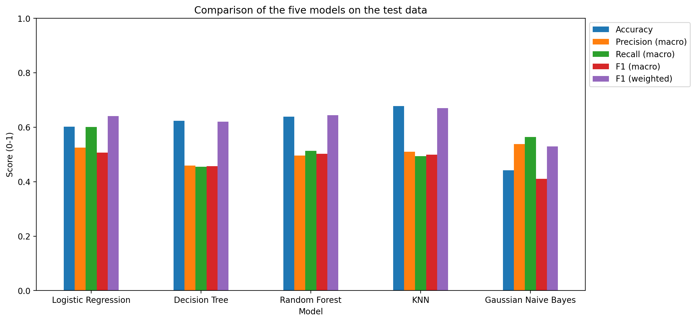
</p>

### Confusion matrices

<table>
  <tr>
    <td align="center">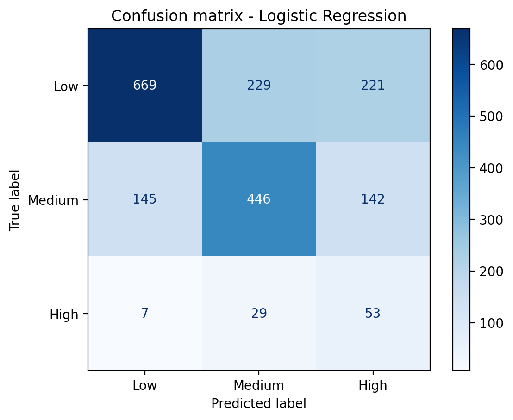<br><b>Logistic Regression</b></td>
    <td align="center">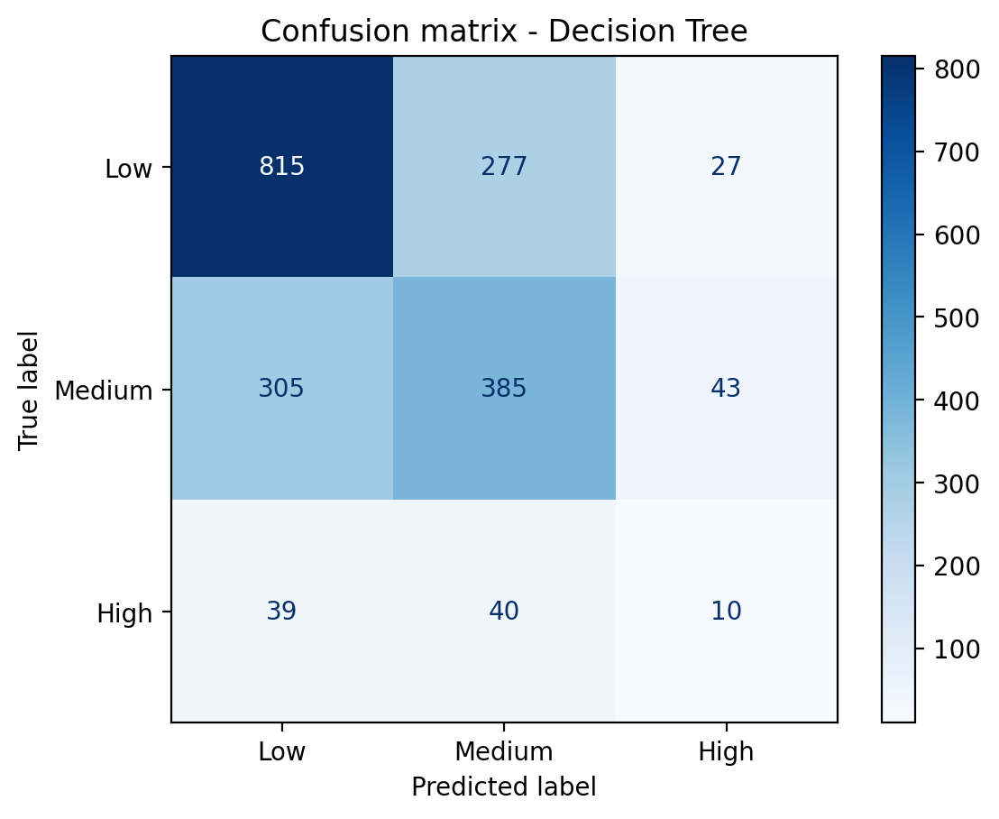<br><b>Decision Tree</b></td>
    <td align="center">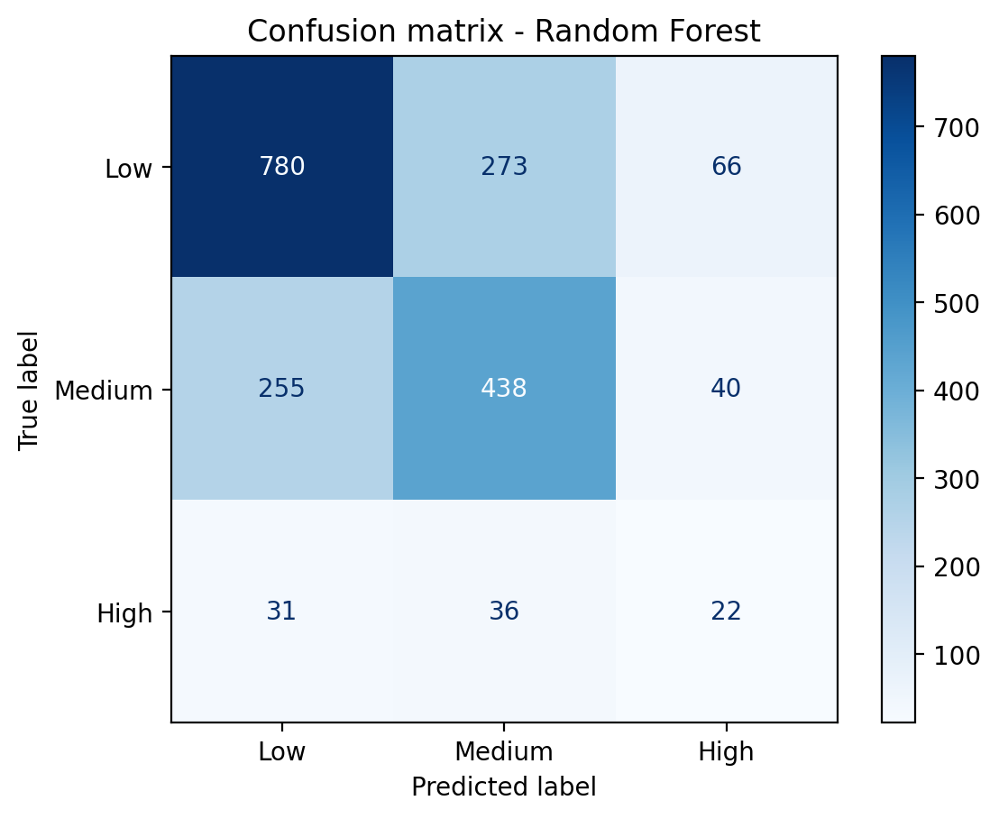<br><b>Random Forest</b></td>
  </tr>
  <tr>
    <td align="center"><br><b>KNN</b></td>
    <td align="center">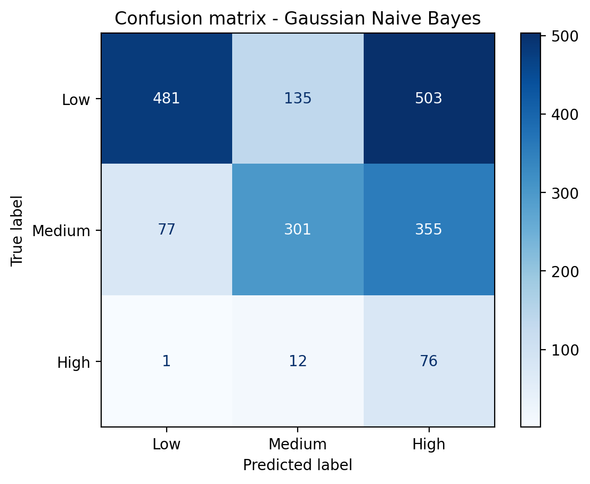<br><b>Gaussian Naive Bayes</b></td>
    <td></td>
  </tr>
</table>

### Why Logistic Regression wins

KNN has the highest accuracy, but accuracy is misleading here: a model can score well just by predicting "Low" most of the time. Macro F1 treats all three classes equally, and on that measure **Logistic Regression comes out on top (0.507)**.

More importantly, Logistic Regression **finds 60% of the High-popularity tracks**. Random Forest finds 25% and KNN only 11%. The trade-off is lower precision: many tracks it flags as "High" are actually Low or Medium.

The final model is saved with its scaler, column list and fill values in `models/best_model.joblib`. I reloaded the file to confirm it gives identical predictions.

### What the models rely on

<p align="center">
  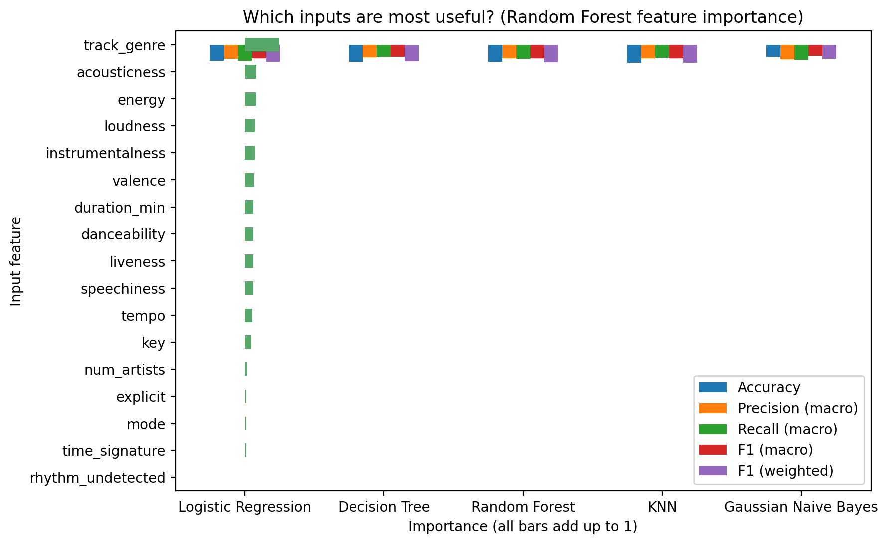
</p>

**Genre accounts for about 25% of the Random Forest's importance.** Each audio feature contributes about 5–8%.

---

## 💡 Conclusions

Genre and sound carry *some* signal about popularity. The best model's macro F1 of about 0.5 compares with 0.24 for always guessing "Low". Even so, **most of what makes a song popular isn't in this dataset.** Artist fame, marketing, playlist placement and release timing almost certainly matter more than danceability or tempo.

### Recommendations

- **🎤 Artists and labels:** tweaking energy or danceability alone won't make a hit. Genre and outside factors matter far more.
- **📱 Streaming platforms:** audio features are excellent for genre-based recommendations and playlists, but weak at predicting popularity.
- **📈 Choosing a model:** use Logistic Regression when spotting potential hits matters most, and KNN when overall accuracy is the priority.
- **🔬 Better predictions:** add artist follower counts, release dates and playlist data.

---

## ⚠️ Limitations

- The analysis uses a stratified sample of about 10,000 tracks, not the full 114,000.
- Popularity is a snapshot in time, and the zero-popularity spikes in some genres may be collection artefacts.
- The Low/Medium/High cut-offs are fixed choices, and the High class is small (89 test tracks).
- The data is observational, so the results show correlation, not causation.

## 🚀 Future work

- Re-run the analysis on the full dataset, or on several samples, to check how stable the results are.
- Bring in release year and artist data from the Spotify API.
- Try regression on the raw popularity score instead of fixed categories.
- Tune probability thresholds to balance precision and recall for the High class.

---

## ▶️ Running the project

```bash
# 1. Clone the repository
git clone https://github.com/NarahariLenka/spotify_analysis.git
cd spotify_analysis

# 2. (Optional) create a virtual environment
python -m venv .venv
.venv\Scripts\activate        # Windows
# source .venv/bin/activate   # macOS / Linux

# 3. Install dependencies
pip install -r requirements.txt

# 4. Run the pipeline in order
python step1_main.py
python step2_preprocessing.py
python step3_eda.py
python step4_objectives.py
python step5_train_models.py
```

Each chart opens in its own window. Close it to move on to the next one. Steps 3–5 only need step 2 to have been run once, because they read the cleaned CSV.

---

## 👤 Author

**Narahari Lenka**
Semester 5 Data Science Project
GitHub: [@NarahariLenka](https://github.com/NarahariLenka)

If you found this project interesting, please consider giving it a ⭐.
